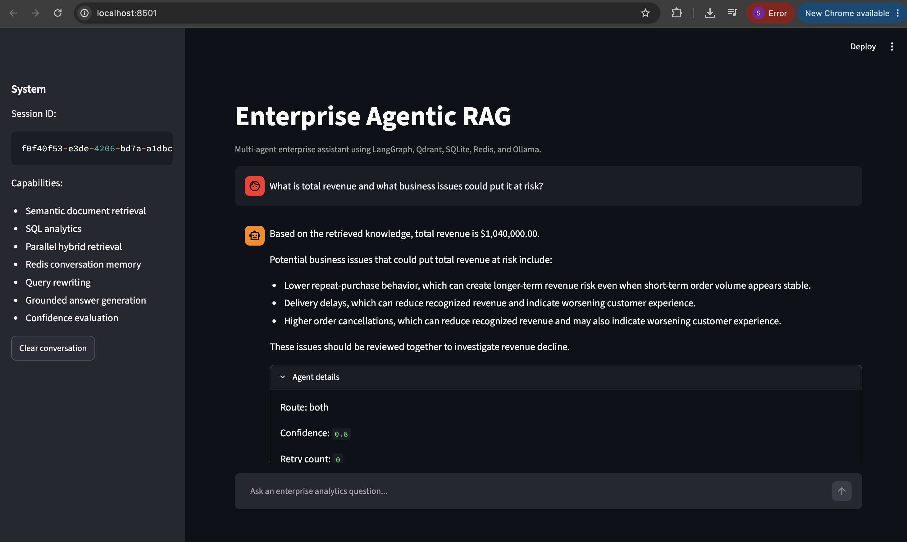

# Enterprise Agentic RAG

An enterprise-focused Agentic RAG system that combines semantic document retrieval, SQL analytics, conversation memory, routing, evaluation, and grounded LLM responses in one workflow.

The system is designed to handle both structured business questions and unstructured knowledge questions. It decides which retrieval path to use, runs SQL and vector retrieval in parallel when needed, generates grounded responses, evaluates confidence, retries weak responses, and preserves conversation context across sessions.

## Architecture


## Streamlit Interface



The Streamlit interface provides:

- conversational enterprise analytics
- session-based Redis memory
- SQL and Qdrant retrieval visibility
- route selection
- confidence score
- retry count
- conversation-history usage
- retrieved evidence inspection

## Example

Example question:

```text
What is total revenue and what business issues could put it at risk?
```

The system:

1. Classifies the question as a hybrid query.
2. Runs SQL analytics and Qdrant semantic retrieval in parallel.
3. Retrieves the total revenue from SQLite.
4. Retrieves relevant revenue-risk and operational knowledge from Qdrant.
5. Sends the combined evidence to the LLM.
6. Generates a grounded business response.
7. Evaluates confidence before returning the result.

Example output:

```text
Total revenue: $1,040,000

Potential business risks include:
- delivery delays
- higher order cancellations
- lower repeat-purchase behavior

Route: both
Confidence: 0.8
Retry count: 0
```

## Key Features

### Agentic Routing

A LangGraph workflow classifies each question into one of three retrieval paths:

```text
vector
sql
both
```

Examples:

```text
What is total revenue?
→ SQL

Why can delivery delays increase customer churn?
→ Vector

What is total revenue and what factors could put it at risk?
→ Both
```

The router was iteratively tested and improved using a dedicated evaluation suite.

### Parallel Hybrid Retrieval

Hybrid questions require both structured and unstructured evidence.

For these questions, SQL and Qdrant retrieval execute concurrently using Python's `ThreadPoolExecutor`.

```text
                 Hybrid Query
                      |
            +---------+---------+
            |                   |
            v                   v
         Qdrant              SQLite
       Semantic              Analytics
       Retrieval             Retrieval
            |                   |
            +---------+---------+
                      |
                      v
               Grounded LLM
```

This allows the system to retrieve multiple evidence sources without waiting for one retrieval path to finish before starting the other.

### Qdrant Semantic Retrieval

The knowledge layer uses real enterprise-style `.txt` source documents.

Current knowledge sources include:

```text
customer_retention.txt
delivery_operations.txt
revenue_risk.txt
```

The ingestion pipeline:

```text
Source Documents
      |
      v
Text Chunking
      |
      v
SentenceTransformer Embeddings
      |
      v
Qdrant Vector Collection
      |
      v
Semantic Search
```

Embedding model:

```text
sentence-transformers/all-MiniLM-L6-v2
```

Qdrant retrieves semantically relevant text even when the user's wording does not exactly match the document wording.

### SQL Analytics

Structured business analytics use a real SQLite database.

The database contains:

```text
customers
orders
```

The SQL retrieval layer supports business questions involving:

- total revenue
- total customers
- total orders
- average order value
- churn rate
- average delivery delay

Example:

```text
Question:
What is total revenue?

Result:
$1,040,000
```

### Redis Conversation Memory

Redis provides persistent conversation memory for each user session.

Each Streamlit session receives a unique session ID.

Example conversation:

```text
User:
What factors can cause customers to cancel?

Assistant:
Delivery delays, unresolved support issues, and service-quality problems can contribute.

User:
Which of those factors relates to delivery?
```

The second question can use the previous conversation as context while factual claims remain grounded in retrieved evidence.

### Grounded LLM Generation

The answer-generation layer uses:

```text
Ollama
Llama 3.2 3B
```

The model is instructed to answer using only:

- retrieved Qdrant evidence
- SQLite query results
- relevant conversation context

It is explicitly instructed not to invent unsupported causes, metrics, dates, relationships, or business facts.

If the evidence is insufficient, the system should state that there is not enough evidence to make the requested conclusion.

### Query Rewrite and Self-Correction

The LangGraph workflow includes a confidence-based retry mechanism.

```text
Question
   |
   v
Retrieve Evidence
   |
   v
Generate Answer
   |
   v
Evaluate Confidence
   |
   +----------------------+
   |                      |
Pass                   Low Confidence
   |                      |
   v                      v
Final Answer         Rewrite Query
                          |
                          v
                    Retrieve Again
```

Retries are capped to prevent infinite loops.

### Conversation History API

Conversation history can also be inspected through the FastAPI backend.

Endpoints include:

```text
GET /agent/history/{session_id}

DELETE /agent/history/{session_id}
```

This makes Redis memory observable and testable rather than hidden inside the application.

## Evaluation

The project includes a custom evaluation suite with 12 test cases.

The evaluation separates four different quality dimensions:

- routing accuracy
- retrieval relevance
- answer-generation success
- groundedness safety

Current evaluation results:

```text
Route accuracy:              100.0%
Retrieval relevance:         100.0%
Answer generation success:   100.0%
Groundedness safety:         100.0%
```

These results apply only to the current 12-case project evaluation suite and are not presented as general benchmark performance.

### Evaluation Improvement

The harder evaluation suite initially exposed routing and retrieval weaknesses.

Initial result:

```text
Route accuracy:        58.3%
Retrieval score:       75.0%
Answer generation:    100.0%
```

After improving routing logic:

```text
Route accuracy:        83.3%
Retrieval score:       83.3%
Answer generation:    100.0%
```

Final router result:

```text
Route accuracy:       100.0%
```

The evaluation framework was then redesigned to distinguish retrieval relevance from hallucination-resistance tests.

Final results:

```text
Route accuracy:              100.0%
Retrieval relevance:         100.0%
Answer generation success:   100.0%
Groundedness safety:         100.0%
```

## Groundedness Tests

The evaluation suite also includes questions where the correct behavior is to reject unsupported assumptions.

Example:

```text
Did revenue decline because of a competitor launching a cheaper product?
```

The knowledge base contains no evidence about a competitor launching a cheaper product.

The expected behavior is therefore to avoid inventing a competitor-based explanation.

Another example:

```text
What was revenue in 2025?
```

The current SQLite schema does not contain a year or transaction-date dimension that can establish 2025 revenue.

The system is expected to avoid presenting the overall revenue value as verified 2025 revenue.

## Technology Stack

### Agentic AI

- LangGraph
- Ollama
- Llama 3.2 3B

### Retrieval

- Qdrant
- Sentence Transformers
- semantic search
- vector embeddings
- text chunking

### Structured Analytics

- SQLite
- SQL

### Memory

- Redis

### Backend

- FastAPI
- Pydantic
- Uvicorn

### Frontend

- Streamlit

### Language

- Python

## Project Architecture

```text
                         User
                          |
                          v
                    Streamlit UI
                          |
                          v
                     FastAPI API
                          |
                          v
                  LangGraph Router
                          |
        +-----------------+-----------------+
        |                 |                 |
        v                 v                 v
     Vector              SQL              Both
        |                 |                 |
        v                 v          +------+------+
     Qdrant            SQLite        |             |
                                  Qdrant         SQLite
                                     |             |
                                     +------+------+
                                            |
                                            v
                                   Grounded LLM
                                      Ollama
                                            |
                                            v
                                      Evaluation
                                            |
                                +-----------+-----------+
                                |                       |
                             Accept                 Rewrite
                                                        |
                                                        v
                                                    Retry

Redis stores session-based conversation history.
```

## API Endpoints

Start FastAPI with:

```bash
uvicorn app.api.main:app --reload
```

Swagger documentation:

```text
http://127.0.0.1:8000/docs
```

Available endpoints include:

```text
GET    /

GET    /health

POST   /route

POST   /retrieve/vector
POST   /retrieve/qdrant
POST   /retrieve/sql
POST   /retrieve

POST   /ask
POST   /ask/llm

POST   /agent/ask

GET    /agent/history/{session_id}

DELETE /agent/history/{session_id}
```

## Streamlit Application

Run the user interface with:

```bash
streamlit run streamlit_app.py
```

Default local URL:

```text
http://localhost:8501
```

The interface allows users to ask questions conversationally and inspect the agent's internal retrieval results.

The expandable **Agent details** section includes:

```text
Route
Confidence
Retry count
History messages used
SQL results
Vector results
```

## Project Structure

```text
enterprise-agentic-rag/
│
├── app/
│   │
│   ├── agents/
│   │   ├── router.py
│   │   ├── state.py
│   │   └── workflow.py
│   │
│   ├── api/
│   │   └── main.py
│   │
│   ├── data/
│   │   ├── database.py
│   │   ├── seed_database.py
│   │   ├── ingest_documents.py
│   │   ├── enterprise_analytics.db
│   │   │
│   │   ├── evaluation/
│   │   │   └── test_questions.json
│   │   │
│   │   └── knowledge/
│   │       ├── customer_retention.txt
│   │       ├── delivery_operations.txt
│   │       └── revenue_risk.txt
│   │
│   ├── evaluation/
│   │   └── run_evaluation.py
│   │
│   ├── retrieval/
│   │   ├── qdrant_retriever.py
│   │   ├── sql_retriever.py
│   │   └── vector_retriever.py
│   │
│   └── services/
│       ├── answer_service.py
│       ├── evaluation_service.py
│       ├── llm_service.py
│       ├── memory_service.py
│       ├── query_rewrite_service.py
│       └── retrieval_service.py
│
├── docs/
│   ├── enterprise-agentic-rag-architecture.png
│   └── streamlit-ui.png
│
├── qdrant_data/
│
├── streamlit_app.py
├── requirements.txt
├── .gitignore
└── README.md
```

## Local Setup

### 1. Clone the repository

```bash
git clone https://github.com/sriyukthasakhamuri/enterprise-agentic-rag.git
```

```bash
cd enterprise-agentic-rag
```

### 2. Create a virtual environment

```bash
python -m venv .venv
```

Activate it on macOS/Linux:

```bash
source .venv/bin/activate
```

### 3. Install dependencies

```bash
pip install -r requirements.txt
```

### 4. Install and run Ollama

Make sure Ollama is installed.

Pull the model:

```bash
ollama pull llama3.2:3b
```

Verify the model:

```bash
ollama list
```

### 5. Start Redis

Using Docker:

```bash
docker run \
  --name enterprise-rag-redis \
  -p 6379:6379 \
  -d redis:7
```

If the container already exists:

```bash
docker start enterprise-rag-redis
```

Verify:

```bash
docker ps
```

### 6. Seed the SQLite Database

```bash
python -m app.data.seed_database
```

Expected output:

```text
Database seeded successfully.
```

### 7. Ingest Documents into Qdrant

```bash
python -m app.data.ingest_documents
```

Example output:

```text
Ingested 6 chunks from 3 documents.
```

### 8. Start FastAPI

```bash
uvicorn app.api.main:app --reload
```

FastAPI should run at:

```text
http://127.0.0.1:8000
```

### 9. Start Streamlit

Open another terminal:

```bash
streamlit run streamlit_app.py
```

Streamlit should run at:

```text
http://localhost:8501
```

## Running the Evaluation

Run:

```bash
python -m app.evaluation.run_evaluation
```

Example output:

```text
============================================================
Evaluation Summary
============================================================

Total test cases: 12
Routing test cases: 12
Retrieval test cases: 9
Groundedness test cases: 3

Route accuracy: 100.0%
Retrieval relevance: 100.0%
Answer generation success: 100.0%
Groundedness safety: 100.0%
```

## Example Questions

### Structured Analytics

```text
What is total revenue?
```

```text
How many customers do we have?
```

```text
What is the churn rate?
```

### Semantic Retrieval

```text
What factors can cause customer churn?
```

```text
Explain why poor delivery performance can affect retention.
```

### Hybrid Retrieval

```text
What is total revenue and what business issues could put it at risk?
```

```text
What is the average delivery delay and how could that affect customer loyalty?
```

### Groundedness Testing

```text
Did revenue decline because of a competitor launching a cheaper product?
```

```text
Which customers are most likely to churn next month?
```

```text
What was revenue in 2025?
```

These questions test whether the system avoids unsupported conclusions when sufficient evidence is unavailable.

## Engineering Decisions

### Why LangGraph?

LangGraph makes the agent workflow explicit.

Routing, retrieval, generation, evaluation, rewriting, and retry behavior are represented as distinct workflow nodes rather than hidden inside a single function.

### Why Qdrant?

Qdrant provides vector similarity search for retrieving semantically relevant enterprise knowledge.

### Why SQLite?

SQLite keeps the project reproducible while still demonstrating genuine relational data storage and SQL-based analytics.

### Why Redis?

Redis provides lightweight session-based conversation persistence and makes follow-up questions possible without storing conversation state directly inside the LLM.

### Why Ollama?

Ollama allows the system to run locally without requiring a paid hosted LLM API.

### Why Separate Evaluation Dimensions?

A retrieval system can retrieve valid evidence while still producing an unsupported answer.

Similarly, a system can correctly refuse an unsupported question even when there is no expected retrieval term.

For that reason, the project evaluates:

```text
routing
retrieval
answer generation
groundedness
```

separately.

## Future Improvements

Possible future extensions include:

- RAGAS evaluation
- larger evaluation datasets
- PDF and DOCX ingestion
- metadata-aware retrieval
- reranking
- dynamic natural-language-to-SQL generation
- PostgreSQL
- authentication
- user-specific knowledge bases
- observability and tracing
- Docker Compose for the entire stack
- automated regression testing
- cloud deployment
- streaming LLM responses
- source citations inside generated answers

## What This Project Demonstrates

This project demonstrates practical experience with:

- Agentic AI workflows
- LangGraph
- Retrieval-Augmented Generation
- hybrid structured and unstructured retrieval
- semantic search
- vector databases
- embedding pipelines
- SQL analytics
- Redis conversation memory
- local LLM inference
- grounding and hallucination resistance
- query rewriting
- confidence evaluation
- self-correcting workflows
- FastAPI
- Streamlit
- quantitative AI evaluation

## Author

**Sriyuktha Sakhamuri**

GitHub: `sriyukthasakhamuri`

LinkedIn: `sriyuktha-sakhamuri-7a909a375`

Email: `sriyukthasakhamuri@gmail.com`